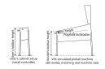

# Upgrading a table to 10.9.0

## Table of Contents
1. [Inputs](#inputs)
2. [VR/XR Setup](#vrxr-setup)
3. [Ball motion trail/blur](#ball-motion-trailblur)

VPX 10.9.0 tries to be entirely backwards compatible and should not require any update to existing tables. Informations below describe new features and how to support them.

## Inputs

As VPX used to be only available under Windows operating systems, its input system was tied to it, using a combination of Direct Input and native Windows methods, but also allowing to select XInput and SDL input for which support was added along the years.
This lead to some issues as these 3 input systems were not implemented in the same way, mixing joystick and gamepad definitions, allowing to select devices or accumulating them, and making the setup incompatible between them.
In VPX 10.9.0, the input system has been entirely rewritten to solve this issue, also integrating and allowing for new uses cases.

***As a consequence, input button/keys/joystick must be redefined when upgrading from an earlier release***

## VR/XR Setup

To support Virtual Reality and Mixed Reality play, tables must include environment elements like a room and a cabinet beside the usual playfield elements.

Each user setup is different, leading to different positioning of things in the real world. For example, a player may use a cabinet where the lockbar 
is placed at 80cm from the ground, while the simulated table has a cabinet with a lockbar placed at 85cm from ground. It is also unlikely that the player's
cabinet lockbar width will perfectly match the one of the emulated pinball cabinet.

VPX handles these differences by performing a few scaling and positioning which are applied depending on the category of each part. 
This is done by placing parts in different layers, and selecting in the layer properties a space reference:
- The **playfield** space corresponds to the playfield parts, including the cabinet which moves with it. It is placed at the playfield level, inclined according to the table inclination, and scaled to match user settings.
  The playfield level is defined as the user defined lockbar height (defined in the real world) minus the distance between the glass and the playfield (bottom glass height).
  The scale is defined by the relative difference between the user defined lockbar width and the emulated table lockbar width, computed from the playfield width.
- The **room** space corresponds to the room parts. These parts are rendered as is, using headset roomscale acquisition, without any transformation.

To sum it up:
- the cabinet, playfield and feets are ***scaled*** according to the user defined ***lockbar width*** against the table's lockbar width, computed from the playfield width,
- the cabinet, playfield and feets are ***positioned*** so that the cabinet 3D model's ***lockbar height*** matches the real world user defined lockbar height,
- the playfield and the cabinet it carries are inclined by the inclination defined by the table author,
- the room is kept untransformed and displayed at real world scale.

An example is provided in the default table which contains the setup and elements for a standard WPC sized cabinet.

## Ball motion trail/blur

VPX used to only provide fake/hacked ball motion trails. These are now deprecated in favor of a cleaner motion blur. There is nothing to do on the table authoring side as these parameters have moved to the general application settings.

[Information applicable to version 10.9.0]
