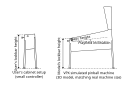

# Virtual Reality

Visual Pinball X can render tables to a VR headset through OpenXR. This document describes how the
virtual world is fitted to your real world space, and which settings adjust it. It also explains
how to use VPX for augmented reality play.

## Table of Contents
1. [Space references](#Space-references)
2. [Augmented Reality](#Augmented-Reality)

## Space references

The scene is rendered in 4 nested space references (used by table parts and groups, see
`PartGroupData::SpaceReference`):

- **Room**: the real world room, unscaled, matching your physical space. Room space parts (e.g. a VR
  room environment model) must be modeled at real world scale.
- **Cabinet feet**: the cabinet legs/body, scaled with the cabinet and stretched so the feet always
  touch the room ground.
- **Cabinet**: the cabinet body, uniformly scaled so its lockbar matches the target lockbar width,
  and positioned so its lockbar lands at the target lockbar height.
- **Playfield**: the simulation space. It follows the cabinet and applies the playfield slope. This
  is the only space that supports physics; everything on it (balls, flippers, ...) is simulated in
  table coordinates.

### Parameter model

The transforms are computed from the *headset room positioning* (which may be imprecise) and the
*target lockbar dimensions*. All distances are in centimeters, angles in degrees.

#### Room positioning (global, auto-saved)

The room positioning corrects an imprecise headset tracking setup (tracking origin drift, wrong
floor height, or simply choosing where to stand). It shifts the whole anchored assembly — room and
cabinet together — so the feet always stay on the corrected ground plane.

- `PlayerVR.RoomYaw` — room orientation around the vertical axis.
- `PlayerVR.RoomOffsetX` / `PlayerVR.RoomOffsetY` / `PlayerVR.RoomOffsetZ` — room offset
  (lateral / front-back / up-down). `RoomOffsetZ` corrects a miscalibrated floor or lets you
  virtually stand higher or lower.

These settings are session state (they depend on the current headset calibration) and are saved back
to the application settings when a game exits.

#### Lockbar dimensions (global)

The cabinet is scaled and positioned so that its lockbar matches a *target* width and height. Each
dimension is either taken from the table file (its authored cabinet model) or overridden by your own
measurement — typically the lockbar of a real cabinet you play on:

- `PlayerVR.OverrideLockbarWidth` — when enabled, scale the cabinet so its lockbar matches
  `Player.LockbarWidth`. When disabled, the cabinet keeps its native (table authored) width, derived
  from the playfield width plus a fixed margin.
- `PlayerVR.OverrideLockbarHeight` — when enabled, position the cabinet so its lockbar stands at
  `Player.LockbarHeight` above the ground. When disabled, the cabinet stands at the table authored
  lockbar height (scaled by the cabinet scale).
- `Player.LockbarWidth` / `Player.LockbarHeight` — the custom lockbar dimensions, measured on your
  real world cabinet. These settings are also used by the (non-VR) cabinet layout preview.

### Per-table offsets (table settings)

Cabinet models may be imprecise about where the lockbar ends relative to the playfield:

- `PlayerVR.TableOffsetY` — correction for the distance between the playfield end and the lockbar
  border.
- `PlayerVR.TableOffsetZ` — correction for the glass height definition (raises or lowers the
  playfield inside the cabinet; the feet stretch to keep touching the ground).

These are saved per table, never globally.

### Adjusting while playing

- **View move keys** (numpad 8/2 for up/down by default, plus bindable front/back/left/right): nudge
  the room offset. Use them to fix small tracking drifts without leaving the table.
- **Align VR view** (numpad 5): recenters the room on your current head pose — resets room offset
  X/Y and yaw so you stand at the position defined by `Player.ScreenPlayerX` / `Player.ScreenPlayerY`
  (the desired standing position relative to the lockbar). The room offset Z is left untouched.
- **Align VR view using controllers**: hold both controllers on your physical lockbar (or where you
  want it) and enable the action. The controllers physically define the lockbar position: the room
  offset and yaw are adjusted so the virtual lockbar lands on the real one. This only affects the
  room positioning — it never writes lockbar width/height nor the override toggles. Additional
  `PlayerVR.ControllerCabYOffset` / `PlayerVR.ControllerCabZOffset` settings let you correct the
  front/back and up/down placement (e.g. the distance between a controller stand and the lockbar,
  or the height of the controller tracking origin above the physical lockbar surface).

### Other setup settings

- `PlayerVR.SeatedTilt` — tilts the whole cabinet toward the player for seated or reclined play
  (view only; physics are unchanged). Setting it non zero disables "Lock Feet to Ground".
- `PlayerVR.LockFeetToGround` — stretches the cabinet feet so they always touch the ground. Disable
  it for setups where the cabinet should not reach the floor (e.g. a mini cabinet on a desk).

### Settings reference

| Setting                        | Scope   | Content                                              |
| ------------------------------ | ------- | ---------------------------------------------------- |
| `PlayerVR.RoomYaw`             | App     | Room orientation (deg)                               |
| `PlayerVR.RoomOffsetX/Y/Z`     | App     | Room offset (cm), session calibration                |
| `PlayerVR.OverrideLockbarWidth`| App     | Use custom instead of table authored lockbar width   |
| `PlayerVR.OverrideLockbarHeight`| App    | Use custom instead of table authored lockbar height  |
| `Player.LockbarWidth`          | App     | Custom lockbar width (cm)                            |
| `Player.LockbarHeight`         | App     | Custom lockbar height (cm)                           |
| `PlayerVR.TableOffsetY`        | Table   | Playfield end to lockbar distance correction (cm)    |
| `PlayerVR.TableOffsetZ`        | Table   | Glass height correction (cm)                         |
| `PlayerVR.SeatedTilt`          | App     | Seated play cabinet tilt (deg)                       |
| `PlayerVR.LockFeetToGround`    | App     | Stretch cabinet feet to the ground                   |
| `PlayerVR.ControllerCabYOffset`| App     | Front/back offset for controller recenter (cm)       |
| `PlayerVR.ControllerCabZOffset`| App     | Up/down offset for controller recenter (cm)          |
| `Player.ScreenPlayerX/Y`       | App     | Standing position used when recentering the view     |

## Augmented Reality

Using PCVR, VPX supports augmented reality (passthrough mode) through colorkeyed renderting. To use
it, you need a VR streamer that supports colorkeyed passthrough (for example Virtual Desktop).

To enable augmented reality:
- enable colorkeyed passthrough mode in your VR streamer application,
- define the keyed color to be full black (all channels at 0) with the lowest tolerance possible,
- in VPX's ingame user interface, enable the augmented reality mode,
- play with a table that does not cover the entire environment with a virtual room.

[Information applicable to version 10.8.1 Beta]